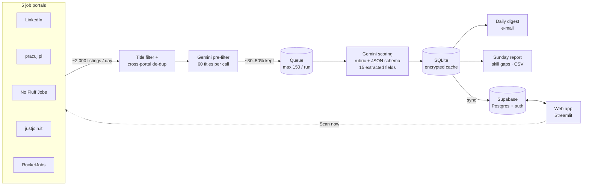

# AI Job Scanner

A small automation that finds fresh job offers and scores them against my profile with an LLM, so every morning I only read the offers worth applying to. Every scored offer is also stored, so over time the scanner builds a dataset of the job market I'm targeting.

## Highlights
- **5 portals, ~2,000 listings a day**, merged and de-duplicated across portals
- **Two-stage LLM workflow** – a cheap batch pre-filter on titles, then detailed scoring with a fixed rubric and a JSON schema (15 extracted fields, salary normalised to PLN/month)
- **A dataset, not just alerts** – every scored offer is stored; a weekly report shows the skills that block near-miss offers, the most required tools and salary medians
- **Runs unattended** – backup schedules, a queue, a time budget, model fallback with a circuit breaker, monitoring of tokens and stage times, 52 automated tests
- **Web app** (Streamlit + Supabase) – morning summary, offers as cards with one-tap status, a kanban application tracker with follow-up reminders, start a scan, edit search settings, market charts; login + Row Level Security
- **Public repo, private data** – profile, keys and search settings in GitHub Secrets; the database is encrypted

## Architecture


**Pipeline:** LinkedIn + pracuj.pl + No Fluff Jobs + justjoin.it + RocketJobs → title filter → cross-portal de-duplication → Google Gemini (structured JSON: fit score + extracted facts) → SQLite → daily HTML e-mail + weekly market & skill-gap report (with CSV export for Power BI)
**Runs:** scans every day (each scheduled scan looks back to the last full scan, so a day GitHub skips loses nothing), weekly report on Sunday – on GitHub Actions (free), no server needed – a main schedule off the full hour plus a backup schedule that only runs if the main one was dropped (GitHub sometimes skips scheduled runs).

## How it works
1. `scanner.py` pulls offers posted in the last 24 h for the searches in `config.yaml` from every portal listed under `sources` (one module per portal in `sources/`: LinkedIn's public job search, the JSON pracuj.pl embeds in its pages, the No Fluff Jobs API and the API shared by justjoin.it and its non-IT sister site RocketJobs). A portal that fails doesn't stop the others – the e-mail says which one broke.
   The same job is often listed on several portals; offers with the same normalised company + title (legal forms like *Sp. z o.o.* and gender tags like *(k/m)* removed) are scored only once. When the per-run cap is reached, portals share it round-robin.
2. Obvious mismatches (e.g. *senior*, *internship*) are dropped by title before any AI call, saving tokens. Optionally `include_title_keywords` keeps only titles containing one of the given words – useful because some portals match keywords loosely.
   At most `max_offers_per_run` offers are scored per run; the rest go to a **queue** in the database and are scored first on the next run (queued offers older than `queue_max_age_days` are dropped, failed ones are retried up to 3 times). The digest says how many offers are still waiting.
3. **AI pre-filter (triage):** new offers are sent to Gemini in batches of 60 titles (title, company, location, portal – one call per batch). Clear mismatches – a different profession, seniority far above the candidate, a language in the title they don't speak – are dropped before the expensive per-offer scoring; when unsure the model keeps the offer, and if a call fails the whole batch is kept. Dropped offers are stored and listed in the weekly report so the filter can be checked. Offers you mark **★ Interested** in the web app are scored on the next run, and their titles are added to the pre-filter prompt as examples of offers to keep (few-shot feedback – the filter improves without retraining a model).
4. Each remaining offer is sent to Gemini in **one call** that returns a JSON object enforced by a schema:
   - **fit** – the model first checks each requirement of the offer (met / partly / missing), then scores five parts – mandatory requirements 40, experience 20, education 15, languages 10, nice-to-haves 15 – with partial credit for related experience and anchors for what 55, 70 and 85 mean. The code adds the parts up (so the total is always consistent) and derives the verdict; temperature 0 keeps the same offer on the same score. Plus strengths, gaps (as short reusable skill names) and a one-line reason. On a test offer the old single-number prompt gave 50–68 across three runs, the new one 68–75;
   - **facts about the offer** – role category, industry, work mode, contract types, salary range (currency, period, gross/net), years required, English level, whether Polish is required, required and nice-to-have tools.
5. Salaries are normalised to **PLN per month** (`fx_to_pln` in `config.yaml`), so offers can be compared.
6. **Every** scored offer – not only the good ones – is saved to `data/jobs.db` (SQLite), together with a compressed copy of the description for later re-scoring/evaluation. Each run is logged too (searches, offers found, filtered, scored, failed).
7. Offers above the threshold are e-mailed as an HTML digest, best first. A digest goes out after every run, even with no matches (`email_every_run`), so a missing e-mail always means the run didn't happen.
8. Every **Sunday** morning a separate schedule (with its own backup) sends the **market & skill-gap report** for the past 7 days, with the full dataset attached as `jobs.csv` – no scanning on that run. See below.
9. **Time budget:** after `time_budget_minutes` (40) the scanner stops scoring and queues the rest, so a slow day never runs into the 60-minute job timeout (a timed-out job would save nothing).
10. **Gemini resilience:** models from `gemini_models` are tried in order – an overloaded model (503) hands the call to the next one, a model that hits its daily free-tier quota or was retired is skipped for the rest of the run, per-minute limits wait at most 60 s, and only *lite* models are used as automatic fallbacks. If Gemini fails several offers in a row the run stops scoring, keeps everything in the queue and says so in the e-mail. Every Gemini error is logged with Google's status.
11. **Monitoring:** every run records Gemini calls, failed calls, input/output tokens, time per stage (search, pre-filter, scoring) and per-portal results including description-fetch errors.
12. **Find offer:** run the workflow with a link (or words from the title/company) in *Find offer* and an e-mail tells you where that offer ended up – scored (score, gaps, e-mailed or not), skipped by the title filter / AI pre-filter / as a duplicate, waiting in the queue, or never returned by a search. Fresh offers are scored before the queue.
13. **Score one offer:** paste a link in the web app (*Offers → Score an offer from a link*) or in the workflow's *Score one offer* field. The offer is scored whatever the filters say and the result comes by e-mail and appears in the app. Links from the five portals are read with the portal's own reader and keep the ids the searches use, so a later scan doesn't score them twice. Any other page (e.g. a company career site) is read as plain text, and Gemini first pulls out the title, company and location.
14. If the portals return 0 offers across all searches, the e-mail carries a warning – that usually means the page layout changed or the request was blocked, not that there are no jobs.

## Weekly market & skill-gap report
All numbers are computed in Python straight from the database; the LLM only receives the aggregates and turns them into at most three learning recommendations, so it cannot invent counts.

- headline numbers vs. the previous week (offers, average score, apply / stretch, near misses);
- **what blocks near-miss offers** – the gaps in offers that scored just below the e-mail threshold (default 40–59). These are the most actionable: closing them turns real offers into "apply";
- most common gaps overall with the week-over-week trend;
- most required tools, and in how many of those offers the tool was the candidate's gap;
- categories with average score and median salary (PLN/month), work-mode split, results per portal, best offers of the week;
- offers skipped by the AI pre-filter (count and the latest titles);
- **system health**: runs, average/longest duration, runs stopped by the time budget, Gemini calls/errors/tokens, average time per stage and per-portal results (found, new, description errors, runs with 0 found).
- up to 3 recommendations from Gemini (skill, why – citing the numbers, first step this week); skipped when fewer than 10 offers were scored.

Gap names are merged case-insensitively. On report days the CSV is attached to the report instead of the daily digest.

## Web app
`app/streamlit_app.py` – a Streamlit app on top of Supabase (Postgres + auth):

| Page | What it does |
|---|---|
| **Home** | the morning summary: new offers and new matches from the last 24 h, follow-ups due (one tap: *followed up* / *rejected*), scanner health, and the best new matches with quick actions |
| **Offers** | paste a link to have any offer scored; offers as cards in the style of the e-mail digest (score ring, salary, work mode, contract, English), search and filters; the selected offer opens beside the list (above it on a phone) with the reason, a score breakdown (requirements, experience, education, languages, nice-to-haves), strengths and gaps and one-tap **Save / Applied / Not interested** – *Applied* sets today's date and a follow-up reminder a week later |
| **Applications** | kanban board: Saved → Applied → Interview → Offer, plus Closed; move a card to the next stage in one tap, edit dates and notes in a pop-over; due follow-ups in red |
| **Scanner** | last scans, queue, skipped offers with the reason (tick the ones you want and press **★ Interested** – see the AI pre-filter above), **Send weekly report now** (GitHub API), and the search settings – keywords, locations, title filters, threshold – which the scanner reads at the start of every run |
| **Market** | what blocks near-miss offers, most required tools, offers per day by portal, salary ranges by category |

A **side panel** on every page shows the scanner's status (last scan, Gemini errors, a warning if no scan for a day), the queue and follow-ups due, with **Scan now** (GitHub API) and *Refresh data*.

Works on a phone: columns stack, the summary turns into a 2 × 2 grid and the offer details move above the list.

The scanner keeps its own SQLite database and syncs to Supabase after each run (one-way for scan data); the app owns `applications` and `settings`, so the two never overwrite each other. The app also owns `feedback` (skipped offers marked interested). Row Level Security lets only the logged-in user read anything; sign-ups are disabled. Local development without Supabase: `python app/demo_data.py data/demo.db && APP_BACKEND=local LOCAL_DB=data/demo.db streamlit run app/streamlit_app.py`.

### Setting it up
1. **Supabase** (free): create a project → *SQL Editor* → run `supabase/schema.sql` → *Authentication → Users → Add user* (your e-mail + password) → *Authentication → Providers → Email*: turn off *Allow new users to sign up*.
2. **GitHub secrets** for the scanner: `SUPABASE_URL` (*Project Settings → API → Project URL*) and `SUPABASE_SERVICE_KEY` (the *service_role* key – never put it in the app).
3. **Streamlit Community Cloud** (free): *Create app* → this repo, branch `main`, file `app/streamlit_app.py` → *Advanced settings → Secrets*:
   ```toml
   SUPABASE_URL = "https://<project>.supabase.co"
   SUPABASE_ANON_KEY = "<anon public key>"
   GITHUB_TOKEN = "<fine-grained token, Actions: read and write on this repo>"
   GITHUB_REPO = "er1rk/job-scanner"
   ```
4. Run the workflow once – the first sync uploads every offer collected so far.

## Data model
| table | one row per | main columns |
|---|---|---|
| `offers` | scored offer | title, company, location, score, verdict, gaps, role_category, work_mode, salary_min/max_pln_month, required_tools, english_level, notified, user_label, status |
| `runs` | scanner run | started/finished, searches, cards found, dropped by title, pre-filtered, scored, failed, notified, queued, stopped by time, stage seconds, Gemini calls/errors/tokens, per-portal stats (JSON), model |
| `queue` | offer waiting to be scored | offer details, queued at, failed attempts |

List fields (gaps, tools, contract types) are exported to CSV joined with ` | ` – in Power Query use *Split column → By delimiter → Rows* to count e.g. the most common gaps.

## Privacy
The repo is public; everything personal stays out of it:
- **Candidate profile, API keys and search settings** live in GitHub Secrets. `config.yaml` holds only neutral public defaults; the real keywords, locations, exclusions and role categories come from the `PRIVATE_CONFIG` secret (or a git-ignored `config.private.yaml` locally) and replace those keys.
- **The database** is kept in the GitHub Actions cache, never in the repo, and only **encrypted** (Fernet, key in the `DB_ENCRYPTION_KEY` secret). A run in Actions without the key stops instead of caching plaintext.
- **Reports and digests** go only to the configured e-mail address.
- **Logs** print counts only – no offer titles, gap names or config values.

## Setup
1. Get a Gemini API key at https://aistudio.google.com/apikey
2. Create a Gmail app password (Google Account → Security → 2-Step Verification → App passwords)
3. Add repository secrets: `GEMINI_API_KEY`, `CANDIDATE_PROFILE`, `EMAIL_ADDRESS`, `EMAIL_APP_PASSWORD`, `DB_ENCRYPTION_KEY` (a long random passphrase – keep a copy, without it the stored data can't be read), `PRIVATE_CONFIG` (your search settings in the format of `config.private.example.yaml`); optional `EMAIL_TO`
4. Actions → *Daily job scan* → *Run workflow* to test (tick *Attach the full dataset* / *Send the weekly report* to get them right away)

Local use:
```bash
pip install -r requirements.txt
export GEMINI_API_KEY=...
python scanner.py --dry-run     # prints results, saves and sends nothing
python scanner.py --export      # data/jobs.db -> data/jobs.csv
python scanner.py --report      # weekly report -> data/report.html (no e-mail)
python -m unittest -v           # offline tests (no network, no API key)
python -m unittest app/test_app.py   # web app tests (pip install -r app/requirements.txt)
```

## Tech
Python · requests · BeautifulSoup · REST/JSON APIs · Streamlit · Supabase (Postgres, auth, RLS) · Altair · Google Gemini API (structured output) · SQLite (encrypted at rest) · SMTP e-mail · GitHub Actions (cron, secrets, cache)
